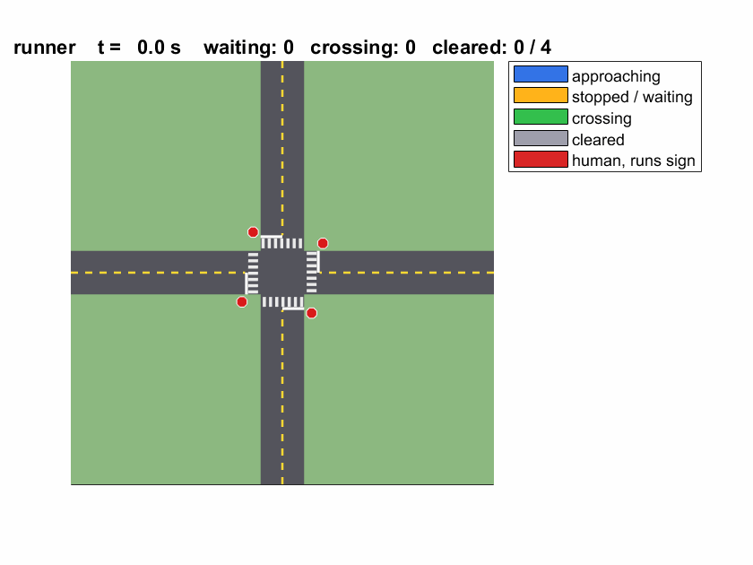

# All-Way Stop with Autonomous Cars
   
A small, self-contained simulator of autonomous cars negotiating a four-way stop,
plus four side demos built on ideas from the MathWorks Automotive Conference talks.

* **Needs:** MATLAB R2016b or newer (written for R2024a). **No toolboxes.**
* **Hardware:** runs on integrated graphics; the 3-D view is plain patch graphics.

## Quick start

Put this folder on the MATLAB path (or `cd` into it), then:

```matlab
run_demo                      % pick a scenario and a view from a menu
run_demo('queue', '3d')       % 12 cars, mixed turns, 3-D view
run_demo('deadlock4')         % 4 cars arrive at exactly the same time
run_demo('runner', '3d', 'runner.gif')   % also saves an animated GIF

run_all_tests                 % headless PASS/FAIL table (about a minute)
results = runtests('AllWayStopTest')     % same idea, MATLAB unit-test framework
```

## Scenarios

| name | what it shows |
|---|---|
| `single` | one car: full stop, 1 s dwell, go |
| `fifo` | first to stop is first to go |
| `tie_right` | simultaneous stop: car on the right goes first |
| `head_on_left` | head-on tie: straight goes before the left turn |
| `concurrent` | movements that do not cross share the intersection |
| `deadlock4` | four simultaneous arrivals, everyone yields right, token breaks the deadlock |
| `queue` | three cars per approach with mixed turns |
| `pedestrian` | pedestrian steps out while a car is mid-turn; others wait for the crosswalk |
| `runner` | a human driver (red) runs the sign; the AVs detect it and hold |
| `false_start` | no V2X and a bad estimate: two cars start together, one backs off |
| `rush_hour` | random traffic from all sides |

Colours: blue approaching, amber waiting, green crossing, grey cleared, red human.

## How the cars decide

Every AV runs the same rules each 50 ms (see the header of `aws_simulate.m`):

1. full stop at the line, then wait `P.dwell`
2. never enter while a conflicting car is in the box
3. never enter if a conflicting car is coming too fast to stop
4. never enter if a pedestrian is, or soon will be, on my path
5. first to stop goes first; tie: right goes first; head-on tie: left turn yields
6. if everyone is waiting for everyone, a patience timer breaks the deadlock

Which movements conflict is computed from the path geometry, not hard-coded.
Underneath the rules every car has an emergency-braking layer for anything on its path.

Two switches in `aws_params.m` change the "architecture":
`P.v2x = true` (cars share exact stop times) or `false` with `P.sensorSigma`
(each car estimates the others with noisy sensors).

## What the tests check

`aws_check.m` fails a run on any collision, any AV crossing its line without right
of way, two conflicting cars in the box together, or any car that never clears.
Scripted scenarios additionally check the exact entry order.

## Side demos (one idea per talk)

| file | idea | from |
|---|---|---|
| `run_montecarlo.m` | delay and misunderstandings vs traffic volume, V2X vs on-board sensing | distributed control systems, chassis/ADAS scenario testing |
| `demo_sensor_fusion.m` | Dempster-Shafer fusion of radar, camera and V2X to judge "will that car stop?" | uncertainty-based sensor fusion |
| `demo_nn_surrogate.m` | train a small network on simulation results, then use it instead of the simulation | GM neural networks for fast simulation |
| `demo_lut_calibration.m` | reward-driven calibration of a lookup table from a baseline | GM ECU calibration with RL |
| `demo_emotor_foc.m` | field-oriented motor control checked against the 10 ms / 5 % torque requirement | e-motor software control |
| `view_in_drivingScenario.m` | optional replay in Automated Driving Toolbox (bird's-eye + chase camera) | RoadRunner-style viewing |

## Make your own scenario

```matlab
clear cars
P = aws_params();
cars(1) = struct('approach', 0, 'turn', 'L', 'tSpawn', 0.0, 'dStart', 40, 'type', 'av');
cars(2) = struct('approach', 2, 'turn', 'S', 'tSpawn', 0.5, 'dStart', 40, 'type', 'av');
cars(3) = struct('approach', 1, 'turn', 'R', 'tSpawn', 1.0, 'dStart', 40, 'type', 'runner');
R = aws_simulate(P, cars, []);   R.name = 'mine';
aws_play(R, struct('view', '3d'));   aws_report(R);
```
`approach`: 0 from South, 1 from East, 2 from North, 3 from West.
