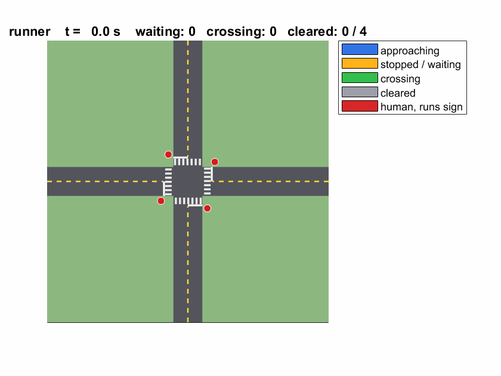

# All-Way Stop Simulation

MATLAB simulation of autonomous cars negotiating a four-way stop. Each car follows the same right-of-way rules, and every scenario is checked automatically for collisions, rule violations and gridlock.



## Requirements

MATLAB R2024a, no toolboxes. `view_in_drivingScenario` is optional and needs Automated Driving Toolbox.

## Usage

```matlab
run_demo                       % pick a scenario from a list
run_demo('queue', '3d')        % 12 cars, mixed turns, 3-D view
run_all_tests                  % PASS/FAIL table for every scenario
runtests('AllWayStopTest')     % same checks as unit tests
run_montecarlo                 % delay vs traffic volume and sensor quality
demo_nn_surrogate              % neural network trained to predict intersection delay
```

## Scenarios

| Name | What it tests |
|---|---|
| `single` | full stop, dwell, go |
| `fifo` | first to stop goes first |
| `tie_right` | simultaneous stop, car on the right goes first |
| `head_on_left` | head-on tie, left turn yields |
| `concurrent` | non-conflicting movements share the intersection |
| `deadlock4` | four simultaneous arrivals, patience timer breaks the tie |
| `queue` | three cars per approach |
| `pedestrian` | pedestrian enters the crosswalk mid-turn |
| `runner` | human driver runs the sign, AVs hold |
| `false_start` | noisy sensors, two cars start together and one backs off |
| `rush_hour` | random traffic |

## Decision rules

Every 50 ms each car:

1. Stops at the line and waits `P.dwell`
2. Won't enter while a conflicting car is in the intersection
3. Won't enter if a conflicting car is approaching too fast to stop
4. Won't enter if a pedestrian is on, or about to be on, its path
5. Goes in stop order, ties go to the car on the right, head-on ties make the left turn yield
6. Breaks four-way deadlocks with a patience timer

Conflicts between movements are computed from path geometry. Each car also has an emergency braking layer for anything on its path.

`P.v2x = true` means cars share exact stop times. With `false`, each car estimates the others from noisy sensors (`P.sensorSigma`).

## Custom scenario

```matlab
P = aws_params();
cars(1) = struct('approach', 0, 'turn', 'L', 'tSpawn', 0.0, 'dStart', 40, 'type', 'av');
cars(2) = struct('approach', 2, 'turn', 'S', 'tSpawn', 0.5, 'dStart', 40, 'type', 'av');
cars(3) = struct('approach', 1, 'turn', 'R', 'tSpawn', 1.0, 'dStart', 40, 'type', 'runner');
R = aws_simulate(P, cars, []);
aws_play(R, struct('view', '3d'));
aws_report(R);
```

`approach`: 0 South, 1 East, 2 North, 3 West.
